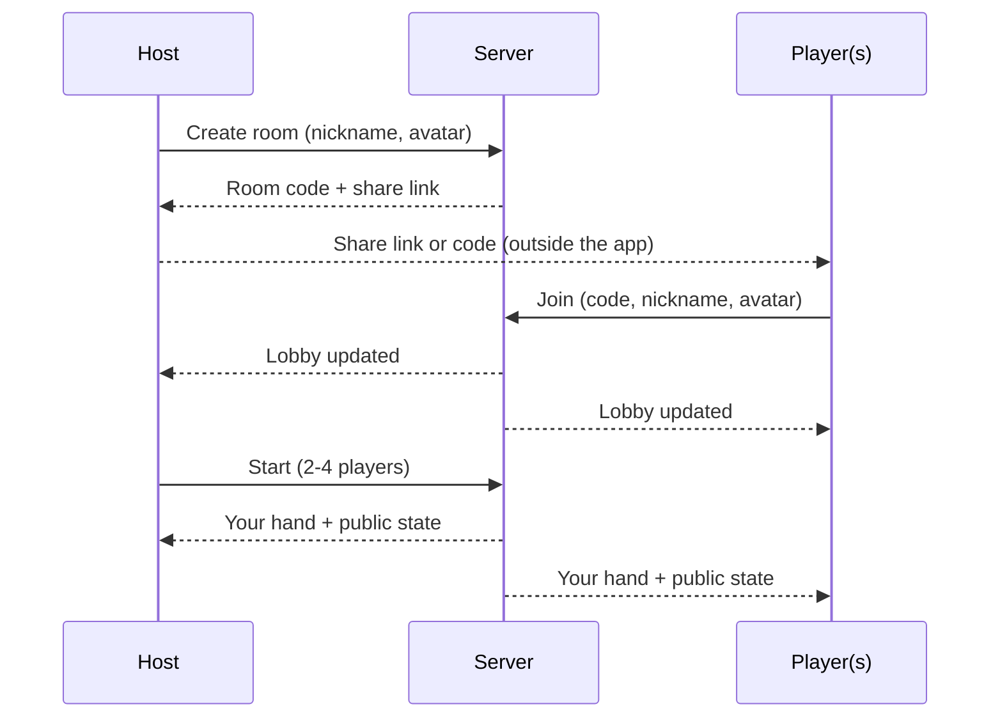
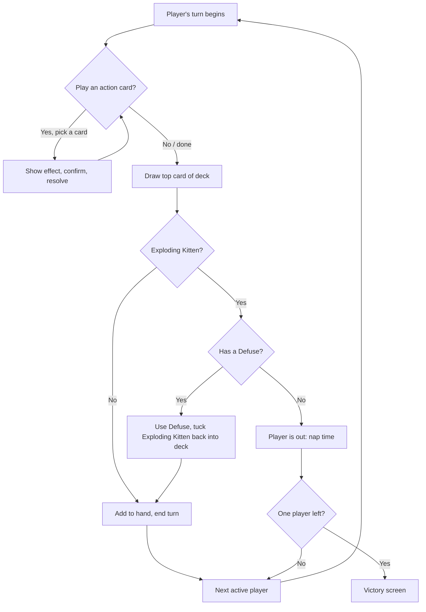
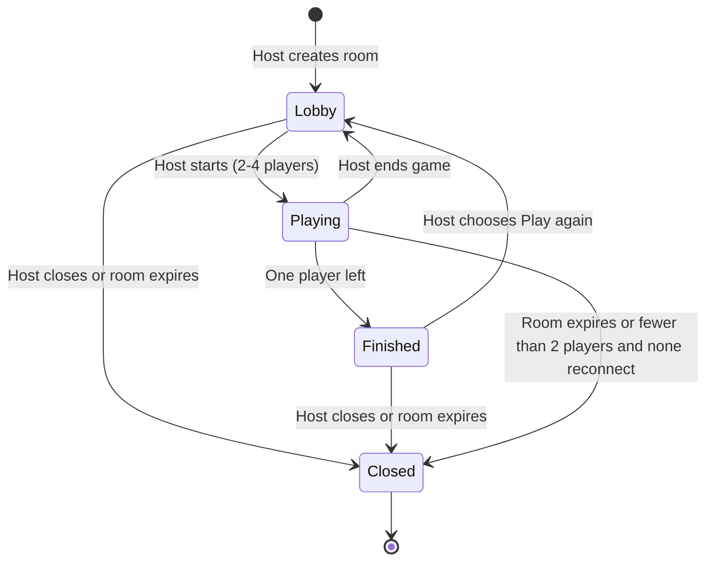

# Product Brief — "Whisker Boom" (working title)

| Item | Value |
| --- | --- |
| Status | Draft v0.2 — updated for online room-based multiplayer (host + players) |
| Last updated | 2026-10-12 |
| Related documents | [UI/UX specification](ui-ux.md) · [User stories](user-stories.md) |
| Scope of this document | Discovery and planning only. No application code exists or is changed by this work. |

**Labelling convention.** *Existing* = verified in the repository. *Proposed* = recommendation made by this document. *Decision needed* = open question with a stated default (see [section I](#i-assumptions-risks-and-open-questions)).

> **Revision v0.2 (product-owner direction).** The game is played **online in private rooms**. There are only two roles: **Host** and **Player**. The host creates a room, receives a **room code** and a **share link**, and sends them to the other players, who join from their own devices. This replaces the v0.1 single-device pass-and-play concept. Consequences: a real-time server is now required; hidden hands are protected by the server instead of a handoff screen; children's nicknames and avatars now reach a server, which raises the privacy and safety bar (see §F and §I).

---

## A. Product Summary

### A1. Name proposal

**Whisker Boom** (working title). The product is *inspired by* the Exploding Kittens genre and now uses that game's **card names**; it must not reuse its artwork, card illustrations, logo, or card text. Alternatives for the title: *Purr-Panic*, *Kitty Kaboom*. **Decision (product owner):** the game uses the Exploding Kittens card names (Exploding Kitten, Defuse, Skip, See the Future, Shuffle, Attack, Favor, Cat cards). The title **Whisker Boom** is kept as a working title. Trademark and copyright risk applies to any public release; run a trademark search before public naming (OQ-01).

### A2. Vision

A warm, colourful, browser-based card game that a family can start in under a minute: one person (the **host**) creates a private room and shares a code or link, the others (**players**) join from their own phones, tablets, or computers, and everyone learns the rules in about two minutes and finishes a round in about ten, with laughs and no frustration.

### A3. Problem / opportunity

- Family card games are fun but need physical cards, a table, and someone who knows the rules.
- Most browser card games are built for adults: dense UI, small tap targets, long rules, and often ads, accounts, or in-app purchases.
- Families are often not in the same room (grandparents, separated parents, cousins), and physical games cannot be shared remotely.
- Opportunity: a **zero-account, zero-install, no-ads** family game that teaches itself while you play, works on the phone, tablet, or laptop a family already has, and starts from one shared link.

### A4. Target audience and personas

| Persona | Description | Needs | Success looks like |
| --- | --- | --- | --- |
| **Mia, 7 (child player)** | Early reader, uses a tablet, short attention span; usually a **player** who joins from a link | Big pictures, few words, instant feedback, no "you lose" shame | Plays her first card unaided, laughs at a surprise, wants a rematch |
| **Sam, 10 (confident child)** | Reads well, likes tactics and bragging rights | Real choices, fast turns, visible progress | Uses See the Future/Skip deliberately and wins at least one game |
| **Priya, 38 (parent)** | Usually the **host**; little time | Learn rules fast, keep the room private and safe, no data collection | Creates a room and shares the link in under 30 s; trusts the content |
| **Grandparent / remote relative, 65** | Joins remotely by tapping a link; low digital confidence, larger text needs | Readable text, clear buttons, patient pacing | Completes a game with no help screen detours |

Age band: **6–10 playing independently, 4–5 with a parent**. **Decision needed (OQ-02).**

### A4a. Roles (no accounts)

Every participant is anonymous and is either a **Host** or a **Player**. A host is also a player. Roles exist only inside a room.

| Capability | Host | Player |
| --- | --- | --- |
| Create a room and get its code and share link | Yes | No |
| Share the code or link | Yes | Can re-share the code only if the host allows (OQ-18) |
| Join a room via link or code | n/a (already in) | Yes |
| Choose a curated nickname and avatar | Yes | Yes |
| See who is in the lobby | Yes | Yes |
| Remove a player from the lobby or game | Yes | No |
| Start the game (2–4 players present) | Yes | No |
| Play cards, draw, see own hand | Yes | Yes |
| Wait for or skip an absent player | Yes | No (sees status only) |
| End the game for everyone / start a rematch / close the room | Yes | No |
| Leave the room or game | Yes (host role then transfers, see US-059) | Yes |

### A5. Core value proposition

*"A family card game you can learn while you play: colourful, kind, ready on any screen, with no sign-up. Share a link and play together."*

### A6. Product principles

1. **Kind by default.** Surprises are funny, never scary or humiliating. Being "out" is a nap, not a loss.
2. **Learn by playing.** Every card explains itself in one plain sentence at the moment it matters.
3. **One obvious next step.** At any moment the screen highlights what to do next.
4. **Big, touchable, readable.** Designed for small hands and tired eyes first.
5. **Private by design.** No accounts, no tracking, no ads. Only a curated nickname and avatar reach the server, and a room and everything in it disappears when the room closes or expires.
6. **Safe to share.** A room is private, small (max 4), host-controlled, and has no chat.
7. **Original.** Own name, characters, art, and wording.

---

## B. Goals and Non-Goals

### B1. MVP goals

| ID | Goal | Linked metric |
| --- | --- | --- |
| G1 | A host can create a room, share a code or link, and 2–4 players on separate devices complete a full game | M1, M2, M11 |
| G2 | First-time players understand the turn and can act without an adult reading rules | M3 |
| G3 | The same game is comfortable on phone (portrait and landscape), tablet, and desktop | M4, M5 |
| G4 | Meets WCAG 2.2 AA for core flows | M6 |
| G5 | Requires no account, shows no ads, and collects no personal data beyond a curated nickname and avatar that are deleted with the room | M7 |
| G6 | Game rules are deterministic and covered by automated tests | M8 |
| G7 | A short connection drop does not end the game: players can reconnect and the host can handle absent players | M12 |

### B2. Explicit non-goals (MVP)

- Public matchmaking or playing with strangers, chat (text, voice, or free-form emoji), friends lists, spectators who are not players.
- Single-device pass-and-play (the v0.1 concept; kept as a future option).
- Bot players (kept as a Could item).
- Accounts, log-in, cloud saves, profiles, parental dashboards.
- Ads, in-app purchases, loot boxes, timers that pressure children.
- Reuse of any Exploding Kittens artwork, card text, or logos. (Card **names** are used by product-owner decision; see section A.)
- Localisation beyond English (keep copy externalised so it is possible later).
- Native mobile apps.

### B3. Future opportunities (outside the initial release)

Bot Buddies to fill empty seats, single-device pass-and-play, QR-code joining, preset reactions or stickers (no free text), extra card packs, themes, "Nope"-style interrupt cards, best-of-N match scoring, read-aloud rules, installable offline PWA, additional languages, parent-controlled settings.

---

## C. User Experience and Game Concept

### C1. Main user journeys

| # | Journey | Outcome |
| --- | --- | --- |
| J1 | **Host:** open site → **Create a room** → pick nickname/avatar → copy the code or share the link → wait in the lobby → **Start** → play → winner → **Play again** | Host journey (US-001, US-003, US-004, US-054, US-055, US-005, US-025, US-026) |
| J1b | **Player:** tap the shared link (or **Join a room** and type the code) → pick nickname/avatar → lobby → play → winner → wait for the host's rematch or leave | Player journey (US-006, US-004, US-055, US-025, US-027) |
| J2 | Open site → **How to Play** → read 4-card tour → back to Home | Learn before playing (US-029) |
| J3 | Mid-game → **Menu** → Rules/Settings/Leave game (host also: End game for everyone) with confirmation | Stay in control without stopping others (US-028) |
| J4 | Draw an Exploding Kitten → use Defuse → hide the Exploding Kitten in the deck | The signature thrill (US-015, US-016) |
| J5 | Draw an Exploding Kitten with no Defuse → "nap time" → keep watching | Gentle elimination (US-017) |
| J6 | First game on a phone → guided hints (Should) | Child plays unaided (US-031, US-032) |
| J7 | Phone sleeps or the tab reloads → automatic **rejoin** into the same seat; if a player stays away too long, the host can skip them | Resilience (US-043, US-058, US-059) |

### C2. Proposed game modes

| Mode | Description | MVP? |
| --- | --- | --- |
| **Private room (host + players)** | The host creates a room and shares a code or link; 2–4 players join from their own devices and play in real time. Each device shows only that player's own hand. | **Must** |
| Bot Buddies | The host fills empty seats with computer players so a small family can still play | Could |
| Single-device pass-and-play | Everyone shares one device with a "pass to…" privacy screen (the v0.1 concept) | Future |
| Public matchmaking / random opponents | Play with strangers | Out of scope (child safety) |

**Decision (OQ-03, resolved by the product owner):** the only mode is a private online room with exactly two roles, host and player. See [roles](#a4a-roles-no-accounts).

### C3. Room setup and onboarding (host and player)

**Host path**

1. Home → **Create a room**.
2. Pick a **nickname** and **avatar** (see below).
3. The room opens with a **room code** (proposed: 6 characters from an unambiguous alphabet, for example `K7M4QX`) and a **share link** (for example `https://<domain>/join/K7M4QX`). Buttons: **Copy code**, **Copy link**, **Share** (the device's native share sheet where available).
4. The lobby lists who has joined. The host can remove a player.
5. When 2–4 players are in the lobby, the host presses **Start**. The room locks, the server builds and deals the deck, and everyone sees their own hand.

**Player path**

1. Tap the shared link (opens **Join** with the code prefilled), or Home → **Join a room** and type the code.
2. Pick a **nickname** and **avatar**.
3. Land in the lobby and wait for the host to start. Clear messages are shown if the room is full, already started, closed, or not found.

**Nicknames (proposed, OQ-14).** Because nicknames are now visible to other people, the MVP uses a **name builder** with curated word lists (for example "Sleepy" + "Biscuit") instead of free text. No real names, photos, or emails are requested.

Optional **guided hints** appear on the first game (Should).

### C4. High-level gameplay loop (proposed simplified ruleset — "Family Rules v0")

> This ruleset is **a product decision, not an official rule set** (OQ-04). It follows the general shape of the genre with original names, and should be validated through playtesting. Card counts are tunable.

**Turn rules (proposed).**
- A turn = play **zero or more** action cards, then **draw one card**. Drawing ends the turn.
- **Skip** ends the turn *without* drawing.
- Each player starts with **1 Defuse + 4 other cards**.
- Exploding Kittens in the deck = **players − 1**, counted from the players who are in the room when the host presses Start. Extra Defuse cards in the deck = **2**.
- Invariant (derived): while ≥2 players remain, the deck always holds ≥1 Exploding Kitten, so the deck cannot run out mid-game.
- **Hidden information (proposed):** the server owns the game. Each device receives only its own hand and public facts (counts, discard pile, whose turn it is). See the Future results and the Exploding Kitten re-insert position are sent only to the player who acted.
- **Absent players (proposed, OQ-15):** a disconnected player has 60 s to reconnect. The game waits only if it is that player's turn. After 60 s the host can **Keep waiting** or **Skip [Name]** (they take a nap and their cards go to the discard pile). A player who chooses **Leave game** is out immediately. If fewer than 2 players remain, the last one wins.

**Proposed MVP card set** (counts are starting values, tune in playtests):

| Card (original name) | Genre equivalent | Effect | Count | Priority |
| --- | --- | --- | --- | --- |
| **Exploding Kitten** | exploding card | Drawn → you are out unless you use a Defuse | players − 1 | Must |
| **Defuse** | defuse | Calms a drawn Exploding Kitten; you tuck it back into the deck | 1 per player + 2 in deck | Must |
| **Skip** | skip | End your turn without drawing | 4 | Must |
| **See the Future** | see the future | Privately look at the top 3 cards | 4 | Must |
| **Shuffle** | shuffle | Shuffle the draw pile | 4 | Must |
| **Cat card** (5 designs) | cat cards | Played as a pair of the same design: take a random card from another player (US-065); a single Cat card is not playable | 20 | Must |
| **Attack** | attack | Next player takes 2 turns | 4 | Should |
| **Favor** | favor | Ask another player for a card | 4 | Should |
| **Nope** | nope | Stop another player's action card. Played out of turn; a Nope can itself be Noped | 5 | Should |

**Nope timing (proposed, OQ-04).** After an action card is played, and only if another player holds a Nope, a short response window opens (about 8 seconds, set by the server). Players holding a Nope may play it or let it go; each Nope flips the outcome, so an odd number stops the card. The window closes when everyone has answered or the timer ends. If nobody holds a Nope the card resolves at once.

Deck at 4 players, MVP set: 27 non-special + 2 Defuse cards + 3 Exploding Kittens = 32 total, 16 dealt to hands, 16 in the draw pile.

**Elimination style (OQ-05).** Default: the player is **out of the round** ("nap time"), keeps watching, and sees a friendly "cheer others on" panel. Alternative for the youngest audience: no elimination, with a points-based soft mode (Could, post-MVP).

### C5. Room and session lifecycle

- **Lobby:** joining is open until the room is full (4) or started. The link and code work only in this state.
- **Playing:** the room is locked; the link shows "This game has already started".
- **Finished:** everyone sees the result; only the host can start a rematch, which returns everyone to the lobby with the same names and avatars.
- **Closed:** the room, its code, and all of its data are deleted. The code is not reused for at least 24 hours.
- **Expiry (proposed, OQ-15):** lobby idle 30 min, game idle 30 min, finished 15 min, absolute maximum 3 h.
- State lives in server memory. The browser keeps only a random **rejoin token** (session storage) so the same device can return to its seat after a reload.

### C6. How children and parents understand it

- Icons + one-line plain-language card text ("Skip: skip your draw!").
- Tap a card once to **see what it does**, tap **Play** to commit, which prevents accidental plays.
- A permanent **?** button opens the How to Play tour and a card guide.
- A banner always states whose turn it is and the one thing they can do next.

---

## D. MVP Scope

### D1. Feature catalogue and priority

| ID | Feature | MoSCoW | Stories | Why this priority |
| --- | --- | --- | --- | --- |
| F-01 | Landing (Create a room, Join a room, How to Play, Settings) and navigation | **Must** | US-001, US-002 | Entry point to everything |
| F-02 | Player identity: curated nickname and avatar | **Must** | US-004 | Personalisation without personal data or free text |
| F-03 | Deck composition and dealing (host starts, server deals) | **Must** | US-005, US-014 | Foundation for all play |
| F-04 | Turn management and private hands on each device | **Must** | US-007, US-008, US-011, US-012 | Core loop; the server hides other players' hands |
| F-05 | Hand, deck, and discard display | **Must** | US-009, US-010 | Players must see state |
| F-06 | Core cards: Skip, See the Future, Shuffle, Cat card | **Must** | US-014 (Cat card), US-018, US-019, US-020, US-040 (Cat card not playable) | Smallest set giving real choices |
| F-07 | Exploding Kitten / Defuse mechanics and elimination | **Must** | US-015, US-016, US-017 | Defining thrill of the genre |
| F-08 | Victory and host-led rematch | **Must** | US-025, US-026, US-027 | Completes the loop, drives retention |
| F-09 | Rules and contextual help | **Must** | US-029, US-030, US-031 | Children must self-serve |
| F-10 | Game menu: leave game, host ends game, confirmations | **Must** | US-028 | Prevents accidental loss; one person cannot pause a shared game |
| F-11 | Responsive layouts | **Must** | US-033, US-034 | Explicit requirement |
| F-12 | Accessibility baseline (WCAG 2.2 AA) | **Must** | US-035, US-036, US-037 | Explicit requirement |
| F-13 | Settings: reduced motion, sound toggle | **Must** | US-038 | Safety and comfort |
| F-14 | Invalid-action feedback and error recovery | **Must** | US-040, US-041 | Children make mistakes |
| F-15 | Privacy and room safety | **Must** | US-042, US-056, US-061 | Child audience; data now reaches a server |
| F-16 | Automated tests for rules and a full game | **Must** | US-046, US-047 | Keep rules correct |
| F-17 | Project scaffold, shared game engine, and real-time room server | **Must (enabler)** | US-050, US-051, US-060 | Nothing exists yet, and online play needs a server |
| F-18 | Rooms: host creates a room, room code and share link, lobby with host controls, expiry | **Must** | US-003, US-054, US-055, US-056 | The core of the host/player model |
| F-19 | Join a room via link or code | **Must** | US-006 | Players need a one-step way in |
| F-40 | Connection resilience: rejoin, absent player, host leaves | **Must** | US-043, US-058, US-059 | Mobile connections drop; a stalled game frustrates children |
| F-21 | Attack card | Should | US-021 | Adds tension; adds rules load |
| F-22 | Favor card | Should | US-022 | Adds interaction; needs a prompt on the friend's device |
| F-41 | Nope card | Should | US-062 | Only out-of-turn action; needs a timed response window |
| F-23 | Guided first game | Should | US-032 | Strong onboarding value |
| F-24 | Recent-action log | Should | US-013 | Helps follow other turns |
| F-26 | Text size setting | Should | US-039 | Accessibility improvement |
| F-27 | Loading and asset-failure handling | Should | US-044 | Reliability |
| F-28 | Automated a11y and performance checks | Should | US-048, US-049 | Keeps quality from regressing |
| F-20 | Bot Buddies fill empty seats (host option) | Could | US-023 | Outside the host/player model; useful later for small rooms |
| F-30 | Sound effects / music | Could | US-052 | Delight; muted by default |
| F-29 | Unsupported-browser notice | Could | US-045 | Graceful failure on old browsers |
| F-32 | QR code for joining a room | Could | US-053 | Easy joining when players are in the same place |
| F-31, F-33…F-36 | Interrupt card, best-of-N, read-aloud, high-contrast theme, PWA/offline | Could | — (not yet storied) | Later |
| — | Public matchmaking, accounts, chat, single-device pass-and-play, monetisation, expansions, official brand assets | **Out of MVP** | — | See B2 |

### D2. Scope reasoning

- **Private rooms with a host and players only.** This is the product owner's direction. One role to create and control the room (host) and one to join (player) keeps the model simple and avoids accounts, friends lists, and matchmaking. It also means a **real-time server is required**, which is the largest MVP cost (see §H) and the main privacy and safety consideration (see §F).
- **Four core action cards only.** Skip, See the Future, and Shuffle give meaningful choices with one-step UI. Attack and Favor add turn-stacking and a prompt on another player's device, so they are Should.
- **No interrupt ("Nope") card in MVP.** Interrupts need timing windows that are hard for young children and add network-latency fairness problems.
- **Cat cards are not playable.** This avoids unneeded rules, and invalid-action feedback is then demonstrable. **Decision needed (OQ-06).**
- **Rooms are ephemeral.** No database and no accounts. Room state lives in server memory and is deleted when the room closes or expires. A random token in the browser only lets a device rejoin its own seat.
- **No bots in MVP.** Bots are outside the host/player model and would add AI work; they are a Could item.
- **No chat.** A child-safety decision: players communicate outside the app (voice or video call, in the same room) and the app shows only curated names and game events.

---

## E. Functional Requirements

Status key: **Existing** (verified in repo), **Proposed**. Nothing below currently exists in the repository; see [section H](#h-technical-context).

| ID | Requirement | Status | MVP | Story |
| --- | --- | --- | --- | --- |
| FR-01 | Landing page offers Create a room, Join a room, How to Play, Settings | Proposed | Must | US-001 |
| FR-02 | Navigation never removes a player from a room or game without confirmation; a share link opens Join with the code prefilled | Proposed | Must | US-002, US-006, US-028 |
| FR-03 | The host creates a room and receives a room code and a share link; the host is also a player | Proposed | Must | US-003, US-054 |
| FR-04 | The host starts the game when 2–4 players are in the lobby; the server shuffles and deals a hand per player | Proposed | Must | US-005, US-014, US-055 |
| FR-05 | Active player and every player's status are always visible | Proposed | Must | US-007 |
| FR-06 | Each device receives only its own player's hand and public information; the server never sends hidden cards to other players | Proposed | Must | US-008, US-060 |
| FR-07 | Player can inspect their hand, select a card, read its effect, and confirm | Proposed | Must | US-009, US-011 |
| FR-08 | Draw ends the turn; Skip ends it without drawing | Proposed | Must | US-012, US-018 |
| FR-09 | Deck count and discard pile top card are visible | Proposed | Must | US-010 |
| FR-10 | See the Future shows the top 3 cards privately; Shuffle shuffles | Proposed | Must | US-019, US-020 |
| FR-11 | Exploding Kitten with Defuse: Defuse is used and the Exploding Kitten is re-inserted at a chosen position | Proposed | Must | US-015, US-016 |
| FR-12 | Exploding Kitten without Defuse: the player is out; game continues | Proposed | Must | US-017 |
| FR-13 | Last remaining player wins; everyone sees the victory screen; the host chooses Play again or closes the room | Proposed | Must | US-025–US-027 |
| FR-14 | How to Play tour, per-card info, and contextual "what now" prompts | Proposed | Must | US-029–US-031 |
| FR-15 | Game menu with Rules, Settings, and Leave game; the host also has End game for everyone; confirmation on destructive actions | Proposed | Must | US-028 |
| FR-16 | Illegal actions are blocked with an explanation and no state change | Proposed | Must | US-040 |
| FR-17 | Unexpected errors show a friendly screen with a way to continue or restart | Proposed | Must | US-041 |
| FR-18 | Reduced-motion and sound settings are honoured, including OS-level reduced motion | Proposed | Must | US-038 |
| FR-19 | Layout adapts across phone portrait/landscape, tablet, desktop | Proposed | Must | US-033 |
| FR-20 | The host can fill empty seats with Bot Buddies | Proposed | Could | US-023 |
| FR-21 | A player who loses connection or reloads rejoins the same seat; connection status is visible | Proposed | Must | US-043 |
| FR-22 | Players join via link or code and choose a curated nickname and avatar | Proposed | Must | US-006, US-004 |
| FR-23 | The lobby lists joined players; the host can remove a player; full, started, closed, and unknown rooms show clear messages | Proposed | Must | US-055, US-006 |
| FR-24 | If a player is absent on their turn, others see why and the host can wait or skip | Proposed | Must | US-058 |
| FR-25 | If the host leaves or disconnects, the host role transfers or the room closes by a defined rule | Proposed | Must | US-059 |
| FR-26 | Rooms expire and are deleted; codes are hard to guess and join attempts are rate-limited | Proposed | Must | US-056, US-061 |

---

## F. Non-Functional Requirements

All numeric targets are **Proposed** (no baseline exists).

| Area | Requirement |
| --- | --- |
| **Browser support** | Latest two stable versions of Chrome, Edge, Firefox, Safari (macOS and iOS 16+), Android Chrome. Minimum viewport 320 × 568 px. |
| **Performance** | Largest Contentful Paint ≤ 2.5 s on a mid-range phone over fast 4G. Initial JS ≤ 200 KB gzip. Input-to-feedback ≤ 100 ms. Animations at 60 fps, with simple transform/opacity effects. Lighthouse Performance ≥ 90 on the home page. |
| **Accessibility** | WCAG 2.2 AA for all core flows. Text contrast ≥ 4.5:1, UI components ≥ 3:1. Touch targets ≥ 48 × 48 CSS px. Keyboard-complete. Screen-reader announcements for turn, draw, and Boom events. Reduced-motion support. See [ui-ux.md §F](ui-ux.md#f-accessibility-and-child-friendly-design). |
| **Child usability** | Reading level ≈ age 6 (short sentences, icons paired with text). No timed pressure. No dark patterns, no ads, no external links on game screens. |
| **Privacy and security** | No accounts. No analytics or third-party scripts by default. Fonts and assets self-hosted (no third-party requests that would reveal a child's IP address). Only a curated nickname, an avatar id, and the room code reach the server. HTTPS and secure WebSocket (WSS) only; CSP in production. Nicknames are rendered as text, never as HTML. **Room safety:** unguessable room codes (proposed 6 characters, about 30 symbols), join rate limiting, max 4 players, room locked once started, host can remove players, no chat, no player-to-player free text. Server validates every message and never trusts the client. Any future analytics must be aggregate and consent-based (OQ-10). |
| **Real-time behaviour** | Action-to-update latency (action sent to all devices updated) p95 ≤ 300 ms on a typical home or mobile connection. Heartbeat-based presence with a 60 s reconnect window. Automatic reconnect with back-off. A visible connection status. All proposed. |
| **Capacity and availability** | MVP target of 200 concurrent rooms (about 800 connections) on a single server instance, with room state in memory. Server restart ends active rooms with a friendly message (acceptable for MVP; revisit with shared state if needed). Uptime target 99 % (proposed). |
| **Reliability** | Game state transitions are pure and deterministic. Illegal moves cannot corrupt state. The server is the single source of truth; clients cannot change state without a valid action. Duplicate or out-of-order messages are ignored safely. An error boundary prevents a blank screen. No data loss on orientation change or window resize. |
| **Maintainability** | Game rules live in a framework-agnostic module separate from UI. Card definitions and copy are data-driven so rules can be tuned without UI rewrites. |
| **Testability** | Injectable random-number source (seeded shuffle). Rules unit-testable without a DOM or a network. Server and client tested with several simulated clients in one room (host plus players). Stable test hooks (roles and labels) on every interactive element. |
| **Child data handling** | Collect the minimum: a curated nickname, an avatar id, and the room code, held only in server memory for the life of the room (maximum 3 h) and then deleted. No accounts, no persistent identifiers beyond a random rejoin token in session storage, no analytics. Hosting logs that contain IP addresses must have a short retention (proposed 7 days) and must not be joined with nicknames. Review against applicable child-privacy rules (for example COPPA, UK Children's Code, GDPR) and decide whether a parent-facing privacy notice and consent step are needed before launch (OQ-10). The host is encouraged to be an adult (OQ-17). |

---

## G. Success Metrics (all proposed targets)

| ID | Metric | Target | How measured |
| --- | --- | --- | --- |
| M1 | Completed games / started games (playtests) | ≥ 80 % | Moderated playtests, 10+ families |
| M2 | Median game duration with 3 players | 8–15 min | Playtest timing |
| M3 | Children aged 6–10 who play a valid first card without adult help | ≥ 85 % | Observed first-use test |
| M4 | Core flow passes on phone portrait, phone landscape, tablet, desktop, with a host and 2 players in separate browser sessions | 100 % of E2E journey cases | Automated E2E (US-047) |
| M5 | Lighthouse Performance / LCP on home; action-to-update latency p95 | ≥ 90 / ≤ 2.5 s; ≤ 300 ms | CI Lighthouse and server latency test (US-049) |
| M6 | Automated a11y violations (serious/critical) on core screens | 0 | axe in CI (US-048) plus manual keyboard and screen-reader pass |
| M7 | Third-party requests and cookies on first load; personal-data fields requested; data remaining after a room closes | 0 / 0 / 0 / 0 | Browser network audit; server data review (US-042, US-056) |
| M8 | Rules engine statement/branch coverage; seeded full-game simulations without invalid state | ≥ 90 % branches; 10,000 simulated games with 0 invariant breaks | Unit tests (US-046) |
| M9 | Invalid-action attempts that end in confusion (playtest) | < 10 % of players stuck > 15 s | Observed playtest |
| M10 | "Would play again" (children) | ≥ 80 % | Post-game smiley-face question in playtests |
| M11 | Players who join successfully from a shared link within 30 s | ≥ 95 % | Playtests and E2E timing |
| M12 | Reconnects that return to the same seat within the 60 s window | ≥ 95 % | Network-interruption E2E tests |

---

## H. Technical Context

### H1. What was inspected

Repository root `d:\COPILOT_Training\ExplodingKitten`, including `README.md`, `AGENTS.md`, `.cspell.json`, `.vscode/settings.json`, `.github/agents/ba.agent.md`, `.github/skills/**` (names and selected skills), `instructions/**` (React, testing, ProjectSetup, BA), `hooks/`, `prompts/`, and `working-artifacts/`. A file-type scan for `package.json`, `.html`, `.css`, `.tsx`, `.jsx`, `.vue`, `.ts`, `.js` found only template files inside `.github/skills/**/references/`.

### H2. Findings

| Question | Finding (evidence) |
| --- | --- |
| Existing application, prototype, or scaffold? | **None.** There is no application source, no `package.json`/lockfile, no build config, no routes, no components, no styles or assets, no game logic, and no tests. |
| What is the repository? | A **shared library of agent skills, instructions, prompts, and hooks** ([README.md](../README.md), [AGENTS.md](../AGENTS.md)). |
| Frontend and backend stack | **Not established.** No client, server, real-time, or hosting configuration exists. |
| Git state | Branch `main` with **no commits** yet; all files untracked. |
| Existing guidance that could shape the app | `instructions/react/*` (feature-first folder layout, React Testing Library, TypeScript strictness), `instructions/testing/copilot-instructions.md` (Playwright with Page Object Model), `instructions/ProjectSetup/**` (project templates), `.github/skills/ba-design-md-starter/` (DESIGN.md and a NashTech default design system), `.github/skills/testing-accessibility-testing/` (WCAG 2.2 checklist). The repository also holds backend and platform guidance that is **not tied to this product**: `.github/skills/spring-boot/`, `instructions/DevOps/csharp.instructions.md`, and `instructions/DevOps/` (Terraform, Kubernetes, Azure Pipelines) plus `.github/skills/devops/`. These are **organisational guidance, not evidence of an implemented stack**. |
| `working-artifacts/` | Contained only an empty `docs/` folder; no existing artifacts were overwritten. |

### H3. Stack recommendation (Proposed — Decision needed OQ-07)

Because nothing exists, the following is the **lowest-risk fit with the repository's own guidance**, not a replacement of any existing stack:

- **React + TypeScript (strict) single-page client.** Matches `instructions/react/*`.
- **A small real-time room server** (new requirement in v0.2). Proposed: **Node.js + TypeScript** with WebSockets (for example `ws` or Socket.IO), so that the **same game-engine module runs on the server** (authoritative) and in client tests. Room state is held in memory (no database) on a single instance for the MVP. Alternatives that fit organisational guidance, if the team prefers them: ASP.NET Core with SignalR (`instructions/DevOps/csharp.instructions.md`) or Spring Boot with WebSocket/STOMP (`.github/skills/spring-boot/`). In that case the rules engine must be ported and kept in sync, which is a real cost; this is the main reason TypeScript is proposed.
- **Framework-agnostic game engine** (pure TypeScript functions: `state × action → state`, injected RNG) in its own module, plus a **view projection** function (`viewFor(playerId, state)`) that removes hidden information before anything is sent to a client.
- **State management on the client:** a reducer-style store fed by server events; the client never computes authoritative game state.
- **Styling:** CSS variables for the design tokens in [ui-ux.md](ui-ux.md), plus either CSS Modules or the team's preferred utility framework.
- **Testing:** Vitest or Jest for the engine and server; React Testing Library for components (as in the React instructions); Playwright with Page Objects for E2E (as in the testing instructions), using several browser contexts (host and players) in one test; `axe` for automated accessibility checks.
- **Hosting:** static hosting for the client plus a small always-on service (container or app service) for the server, behind HTTPS/WSS. The repository's DevOps skills target Azure DevOps and AKS, but nothing here commits the product to them.
- **Build tool:** Vite is plausible but is not prescribed anywhere in the repo.

If the team prefers another stack, the engine/server/client split and every requirement here still apply.

### H4. Likely implementation areas

`engine/` (cards, deck, turn state machine, view projection; shared by client tests and server), `server/` (room manager, WebSocket gateway, presence and reconnect, expiry, rate limiting), `features/rooms` (create, join, lobby, share), `features/game` (board, hand, overlays), `features/rules`, `features/settings`, shared `components/common`, `styles/tokens`, `assets/` (original SVG art), `tests/`. The client follows the feature-first layout in `instructions/react/react-archiecture.instructions.md`.

### H5. Constraints

- All art must be **original or properly licensed**. No Exploding Kittens artwork, logos, or card text. Card names follow the Exploding Kittens set by product-owner decision.
- Fonts must be open-licence and self-hosted.
- Hidden-information must be enforced **on the server**; a client must never receive other players' cards.
- A running server is now an operational dependency: hosting, monitoring, cost, and incident handling are required before launch (OQ-20).
- Single-instance in-memory rooms mean a server restart ends active games; acceptable for MVP.
- Children's data now crosses the network, so privacy, retention, and logging decisions are launch gates (OQ-10).

---

## I. Assumptions, Risks, and Open Questions

### I1. Assumptions

| ID | Assumption |
| --- | --- |
| A1 | MVP is a single-page web client plus a small real-time server that holds room state in memory (no database). |
| A2 | Each player uses their own device with an internet connection (home Wi-Fi or mobile data). Players usually talk to each other outside the app (same room, phone, or video call); the app has no chat. |
| A3 | English only, with copy kept in one place so it can be translated later. |
| A4 | Original art is produced by the team (vector SVG) or licensed; design agent placeholders are acceptable for early builds. |
| A5 | Game mechanics inspired by the genre can be reimplemented with original names and wording; **legal confirmation is still required** (OQ-01). |
| A6 | The host is usually an adult, but this is not enforced (OQ-17). The share link is sent through a channel the host trusts (messaging app, email). |

### I2. Risks

| ID | Risk | Likelihood / Impact | Mitigation |
| --- | --- | --- | --- |
| R1 | Trademark/copyright claims over name, art, or text | Med / High | Original name, art, wording; legal review before launch |
| R2 | Rules too complex for ages 6–7 | Med / High | Four-card MVP set, tour, per-card help, playtests, tunable counts |
| R3 | Hidden information leaks (client inspection or a faulty server message) | Med / High | Server-authoritative game; each client gets only its own hand and public data; See the Future and re-insert results go only to the acting player; tests assert no hidden data in other players' messages (US-060) |
| R4 | Small cards with 7+ in hand are hard to tap on phones | High / Med | Scrollable snap hand, two-step select/confirm, minimum visible card width |
| R5 | Elimination upsets young children | Med / Med | "Nap time" framing, spectator panel, short rounds, quick replay |
| R6 | Scope creep (bots, chat, matchmaking, accounts) delaying MVP | Med / High | Fixed MVP list (D1); Should items staged after core release |
| R7 | Accessibility retrofitted late | Med / High | A11y criteria inside story DoD; automated checks in CI |
| R8 | Child-privacy compliance misunderstood now that data reaches a server | Med / High | Minimum data (curated nickname and avatar), ephemeral rooms, no analytics, short log retention, legal review before launch |
| R9 | No existing stack, server, hosting, or CI to reuse | Certain / High | Stage 0 foundations (US-050, US-051, US-060); decide OQ-07 and OQ-20 early |
| R10 | A stranger guesses or receives a room code or link | Med / High | Unguessable codes, rate limiting, room locks on start, host can remove players, no chat, a short "only share with people you trust" message (US-054, US-061) |
| R11 | An inappropriate nickname is shown to a child | Med / High | Curated name builder in MVP (OQ-14); host can remove a player |
| R12 | Connection drops stall a game or frustrate children | High / Med | 60 s rejoin window, clear "waiting for…" status, host can skip an absent player (US-043, US-058) |
| R13 | A server outage or restart ends all active games | Med / Med | Friendly "room ended" message, quick restart, monitoring; shared state is a later enhancement |
| R14 | Host leaves and strands the room | Med / Med | Defined host transfer or close rule (US-059) |

### I3. Open questions and decisions needed

| ID | Question | Recommended default | Affects |
| --- | --- | --- | --- |
| OQ-01 | Final product name, and legal clearance for genre-inspired mechanics | "Whisker Boom" working title; legal review | Everything public-facing |
| OQ-02 | Target age band | 6–10 independent, 4–5 with parent | Copy, UI density |
| OQ-03 | Single device vs multiple devices | **Resolved (product owner):** private online rooms with host and players, each on their own device | Scope, architecture |
| OQ-04 | Ruleset: simplified "Family Rules v0" vs fuller official-style rules | Family Rules v0, tuned by playtest | US-005, US-011–US-023 |
| OQ-05 | Elimination style: out-of-round vs soft mode | Out-of-round with "nap time" | US-017, US-025 |
| OQ-06 | Are Cat cards playable? | Not playable in MVP | US-014 |
| OQ-07 | Frontend and server stack and hosting | React + TypeScript client; Node.js + TypeScript WebSocket server sharing the engine; single instance | Stage 0 |
| OQ-08 | Art source (in-house, commissioned, licensed) | In-house SVG placeholders, upgrade later | Stage 2 |
| OQ-09 | Sound: include in MVP? | Could; muted by default | US-052 |
| OQ-10 | Child-privacy and legal requirements now that nicknames, avatars, and IP addresses reach a server (consent, privacy notice, log retention, jurisdictions) | No analytics; minimum data; legal review is a launch gate | NFR, US-042 |
| OQ-11 | Do players need a way to talk? | No in-app chat; players use voice or video outside the app | Scope, safety |
| OQ-12 | Bot Buddies difficulty and whether bots belong in a host/player room | Could; one gentle difficulty if built | US-023 |
| OQ-13 | Maximum players per room | 4 (UI and deck balance); revisit for 5+ | US-055 |
| OQ-14 | Nickname input: curated name builder vs free text with filtering | Curated name builder (no free text) in MVP | US-004 |
| OQ-15 | Timeouts and retention: reconnect window, expiry times, absolute room lifetime | 60 s reconnect; lobby idle 30 min; game idle 30 min; finished 15 min; max 3 h | US-056, US-058 |
| OQ-16 | When the host leaves: transfer or close? | Transfer to the longest-present player after the 60 s window; close if none | US-059 |
| OQ-17 | Can a child be the host? Do we need adult messaging? | Anyone can host; the Create screen suggests "Ask a grown-up to be the host" without blocking | US-003 |
| OQ-18 | Can players re-share the room code, or only the host? | Players can see the code but the Share button is host-only | US-054 |
| OQ-19 | Room code length and alphabet; link format and domain | 6 characters, no look-alike symbols; `/join/<code>` | US-054, US-061 |
| OQ-20 | Server hosting, region, cost, monitoring, and on-call ownership | Single small instance in one region; basic uptime monitoring | Stage 0, release |

---

## J. Delivery Roadmap

| Stage | Outcome | Contents | Exit criteria |
| --- | --- | --- | --- |
| **0. Foundations** | Buildable, testable skeleton with a running room server | US-050, US-051 (engine incl. seeded RNG and view projection), US-060 (server skeleton), design tokens, US-046 (engine tests, started) | CI runs lint and unit tests; two test clients can create and join a room and play a simulated game |
| **1. Playable core** | A host and players can finish a game from separate devices | US-001–US-008, US-054, US-055, US-009–US-012, US-014–US-020, US-025–US-027 | Host creates a room, shares the link, 2–4 players play to a winner on desktop and phone, with placeholder art |
| **2. Safe, resilient, kid-friendly** | Shippable to families | US-028–US-031, US-033–US-038, US-040–US-043, US-056, US-058, US-059, US-061, US-047 | WCAG 2.2 AA manual pass, multi-client E2E on 4 viewport classes, reconnect tests, usability playtest #1 |
| **3. Enhancements (Should)** | Easier to start, richer play | US-013, US-021, US-022, US-032, US-039, US-044, US-048, US-049 | More cards and onboarding; a11y and perf checks in CI |
| **4. Release readiness** | Confident public launch | Art polish, playtest #2, legal/privacy review, hosting and monitoring ready, Could items if capacity allows (US-023, US-052, US-053) | M1–M12 reviewed; OQ-01, OQ-08, OQ-10, OQ-20 closed |
| **Post-MVP** | Growth | Single-device pass-and-play, preset reactions, packs, themes, PWA, more languages | Separate brief |

Stage 1 is the earliest point where the product is *playable*; Stage 2 is the earliest point where it is *shippable to families*.

---

## Appendix — Traceability (Must-have features → stories)

See the [coverage matrix in user-stories.md](user-stories.md#coverage-matrix-mvp-features--stories).
